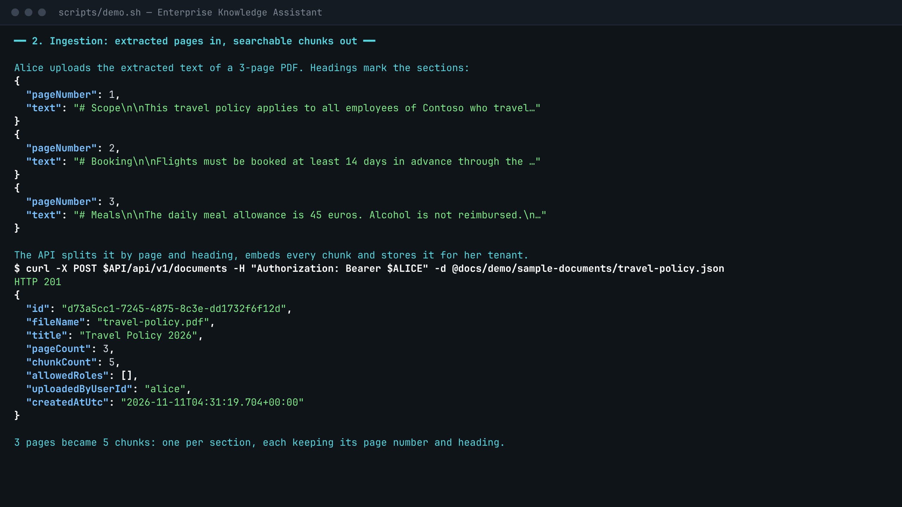
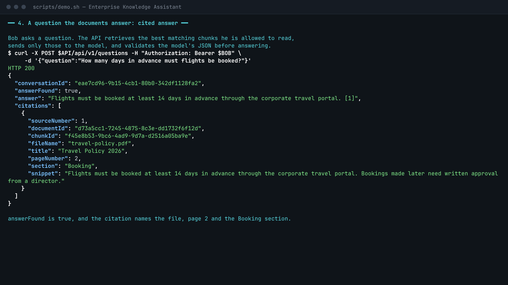
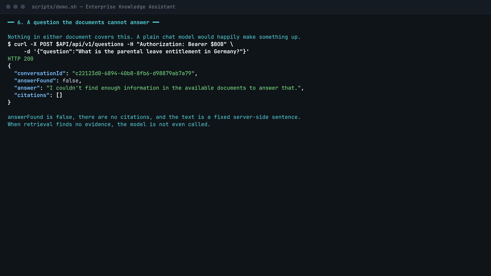
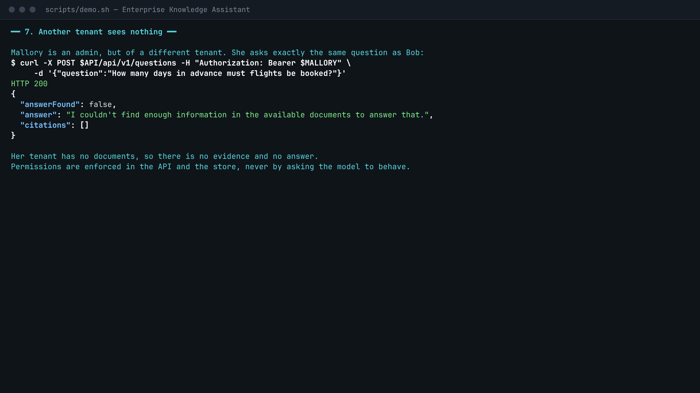

# Enterprise Knowledge Assistant

Employees ask questions about internal documents and get answers with citations (file, page,
section). When the documents don't contain the answer, the assistant says so instead of guessing.

```
client ──JWT──▶ .NET 10 Minimal API ──▶ retrieval (tenant + role filtered) ──▶ model ──▶ validated, cited answer
                      └─ ingestion ──▶ document-aware chunking ──▶ embeddings ──▶ vector store
```

**Demo (4 minutes, no audio):** [docs/demo/demo.mp4](docs/demo/demo.mp4) — ingestion, cited answers, an
unanswerable question and the tenant boundary. It is a capture of one real run of `scripts/demo.sh`.

| Document | What it covers |
|---|---|
| [Day 11 checkpoint](docs/checkpoint-day11.md) | What works end to end, and the top five remaining gaps |
| [Requirements](docs/01-requirements.md) | Use case, constraints, acceptance criteria |
| [Architecture](docs/02-architecture.md) | Projects, security model, database schema, API contracts |
| [Implementation plan](docs/03-implementation-plan.md) | Step-by-step plan and testing strategy |
| [Learning notes](docs/learning-notes.md) | Concepts behind each day and where they live in the code |
| [Backlog](docs/backlog.md) | Done / next / later |

## Contents

- [Setup](#setup)
- [Run it](#run-it)
- [Sample requests](#sample-requests)
- [Screenshots](#screenshots)
- [Configuration](#configuration)
- [Using a real model](#using-a-real-model)
- [Authentication and roles](#authentication-and-roles)
- [Project layout](#project-layout)
- [Recording the demo again](#recording-the-demo-again)

## Setup

| Tool | Used for | Check |
|---|---|---|
| .NET 10 SDK | build, test, run | `dotnet --version` |
| Node.js LTS | mock model provider, scripts | `node -v` |
| Git | source control | `git --version` |
| jq, curl, openssl | smoke test and demo scripts | `jq --version` |
| Docker Desktop | not needed yet (later: pgvector, containers) | `docker --version` |

```bash
dotnet build
```

```bash
dotnet test
```

Tests run offline. The model and embedding ports are replaced by fakes and the store is a temporary SQLite file.

## Run it

### Fastest: the scripted flows

Both scripts build the solution, start the mock provider and the API on spare ports, mint throwaway
tokens, and stop everything when they finish.

```bash
scripts/demo.sh
```

```bash
scripts/smoke-test.sh
```

`demo.sh` is a paced walkthrough (set `DEMO_SPEED=0` to skip the pauses). `smoke-test.sh` asserts 40+
behaviours (auth, ingestion, citations, unknown answers, tenant isolation, streaming, limits, timeouts)
and exits non-zero on any failure.

### By hand

1. Start the mock provider, an OpenAI-compatible stand-in. `appsettings.Development.json` already points at it.

   ```bash
   node tools/mock-llm/server.mjs
   ```

2. Start the API on <http://localhost:5080>.

   ```bash
   dotnet run --project src/KnowledgeAssistant.Api
   ```

3. Create a development token. The signing key goes to user-secrets, never to the repository.

   ```bash
   dotnet user-jwts create --project src/KnowledgeAssistant.Api --audience api://knowledge-assistant --claim tid=contoso --role Knowledge.Contributor -o token
   ```

4. Put the printed token and the base URL in your shell, then use the sample requests below.

   ```bash
   export API=http://localhost:5080 TOKEN=<paste the token>
   ```

The OpenAPI document is at `/openapi/v1.json` (Development only).

## Sample requests

All `/api/v1/*` endpoints need `Authorization: Bearer <token>`. The responses below are real output from the
demo run; ids and timestamps will differ on your machine.

### Ingest a document

The API takes text that has already been extracted: one entry per page. A plain text file is one page.
Headings (`# Markdown`, `2.1 Numbered`, `ALL CAPS`) become the section shown in citations.

```bash
curl -s -X POST $API/api/v1/documents -H "Authorization: Bearer $TOKEN" -H 'Content-Type: application/json' -d @docs/demo/sample-documents/travel-policy.json
```

```json
{
  "id": "5f91f2f4-b864-4c11-a59e-2f245afaa748",
  "fileName": "travel-policy.pdf",
  "title": "Travel Policy 2026",
  "pageCount": 3,
  "chunkCount": 5,
  "allowedRoles": [],
  "uploadedByUserId": "alice",
  "createdAtUtc": "2026-11-11T04:24:17.998+00:00"
}
```

Request body shape ([full example](docs/demo/sample-documents/travel-policy.json)):

```json
{
  "fileName": "travel-policy.pdf",
  "title": "Travel Policy 2026",
  "allowedRoles": ["Finance.Reader"],
  "pages": [{ "pageNumber": 1, "text": "# Scope\n\nThis travel policy applies to ..." }]
}
```

`title` and `allowedRoles` are optional. Without `allowedRoles`, every member of the tenant can read the
document. There is no tenant field: the tenant always comes from the token.

### Ask a question the documents answer

```bash
curl -s -X POST $API/api/v1/questions -H "Authorization: Bearer $TOKEN" -H 'Content-Type: application/json' -d '{"question":"How many days in advance must flights be booked?"}'
```

```json
{
  "conversationId": "acf2b938-87c6-4485-8300-a49649db2308",
  "answerFound": true,
  "answer": "Flights must be booked at least 14 days in advance through the corporate travel portal. [1]",
  "citations": [
    {
      "sourceNumber": 1,
      "documentId": "5f91f2f4-b864-4c11-a59e-2f245afaa748",
      "chunkId": "ed88c7b5-dc01-4be8-9d31-baf472a92f08",
      "fileName": "travel-policy.pdf",
      "title": "Travel Policy 2026",
      "pageNumber": 2,
      "section": "Booking",
      "snippet": "Flights must be booked at least 14 days in advance through the corporate travel portal. Bookings made later need written approval from a director."
    }
  ]
}
```

Send the returned `conversationId` with a follow-up to continue the conversation.

### Ask a question the documents cannot answer

```bash
curl -s -X POST $API/api/v1/questions -H "Authorization: Bearer $TOKEN" -H 'Content-Type: application/json' -d '{"question":"What is the parental leave entitlement in Germany?"}'
```

```json
{
  "conversationId": "dbaf3fa9-95e3-40aa-857a-5cbc0441f786",
  "answerFound": false,
  "answer": "I couldn't find enough information in the available documents to answer that.",
  "citations": []
}
```

A response is always one of these two shapes: answered with at least one citation, or not answered with none.

### Other endpoints

```bash
curl -s "$API/api/v1/documents?page=1&pageSize=20" -H "Authorization: Bearer $TOKEN"
```

```bash
curl -s -X DELETE $API/api/v1/documents/<id> -H "Authorization: Bearer $TOKEN" -o /dev/null -w '%{http_code}\n'
```

```bash
curl -s -X POST $API/api/v1/chat -H "Authorization: Bearer $TOKEN" -H 'Content-Type: application/json' -d '{"message":"What is a context window?"}'
```

```bash
curl -sN -X POST $API/api/v1/chat/stream -H "Authorization: Bearer $TOKEN" -H 'Content-Type: application/json' -d '{"message":"Say hello"}'
```

```bash
curl -s $API/health/ready
```

Errors are always `application/problem+json`:

| Status | Meaning |
|---|---|
| 400 | Validation failed; `errors` lists each field |
| 401 / 403 | Missing or invalid token / missing role or tenant claim |
| 404 | Not found, or not visible to the caller (never reveals another tenant's data) |
| 409 | The same content is already ingested in this tenant |
| 413 / 429 | Body too large / per-user limit on model-backed endpoints exceeded |
| 502 | The model's output failed validation twice |
| 503 / 504 | Model provider unavailable or not configured / timed out |

## Screenshots

There is no UI yet, so these show the API being driven from a terminal. They are generated from the same
recorded run as the video.

**Ingestion** — three extracted pages become five chunks, one per section.



**Cited answer** — the citation names the file, page and section.



**Unanswerable question** — a fixed "not enough information" answer, no citations.



**Tenant isolation** — an admin of another tenant asks the same question and gets nothing.



## Configuration

Settings live in `src/KnowledgeAssistant.Api/appsettings.json`. Override any of them with an environment
variable by replacing `:` with `__` (for example `Llm__BaseUrl`), or with `dotnet user-secrets` locally.
Invalid values stop the application at startup with a message naming the setting.

### Model provider — `Llm`

| Name | Default | Meaning |
|---|---|---|
| `Llm:BaseUrl` | *(empty)* | OpenAI-compatible base URL. Empty means model calls return 503. Must be https unless localhost. |
| `Llm:ApiKey` | *(empty)* | **Secret.** Set with user-secrets or `Llm__ApiKey`; never in appsettings. |
| `Llm:ApiKeyHeaderName` | `Authorization` | `Authorization` sends `Bearer <key>`; any other name (Azure: `api-key`) sends the raw key. |
| `Llm:ChatModel` | *(empty)* | Chat model, or Azure deployment name. |
| `Llm:EmbeddingModel` | *(empty)* | Embedding model, or Azure deployment name. |
| `Llm:RequestTimeout` | `00:00:30` | Limit for one non-streaming call. Exceeding it returns 504. |
| `Llm:StreamTimeout` | `00:02:00` | Limit for one streaming call. |
| `Llm:MaxTokensParameterName` | `max_tokens` | Use `max_completion_tokens` for newer OpenAI/Azure models. |
| `Llm:StructuredOutputMode` | `JsonSchema` | `JsonSchema`, `JsonObject` or `None`, depending on what the provider supports. |

### Answers and chat — `Generation`, `Retrieval`, `Conversation`

| Name | Default | Meaning |
|---|---|---|
| `Generation:AnswerTemperature` | `0.1` | Temperature for document-grounded answers. |
| `Generation:ChatTemperature` | `0.7` | Default temperature for `/chat`. |
| `Generation:MaxOutputTokens` | `1024` | Output cap per model reply. |
| `Retrieval:TopK` | `5` | Chunks given to the model per question. |
| `Retrieval:MinScore` | `0.25` | Minimum cosine similarity for a chunk to count as evidence. **Tune per embedding model.** |
| `Conversation:MaxHistoryMessages` | `6` | Earlier messages included in a prompt; `0` disables history. |
| `Conversation:MaxHistoryCharacters` | `6000` | Character budget for that history. |

### Ingestion — `Ingestion`

| Name | Default | Meaning |
|---|---|---|
| `Ingestion:ChunkSizeCharacters` | `1200` | Maximum chunk length (about 300 tokens). |
| `Ingestion:ChunkOverlapCharacters` | `200` | Text repeated between neighbouring chunks; at most half the chunk size. |
| `Ingestion:MaxPages` | `500` | Pages per document. |
| `Ingestion:MaxTotalCharacters` | `2000000` | Characters per document. |
| `Ingestion:MaxChunksPerDocument` | `5000` | Chunks per document. |
| `Ingestion:EmbeddingBatchSize` | `64` | Chunks per embedding request. |

### Platform

| Name | Default | Meaning |
|---|---|---|
| `ConnectionStrings:KnowledgeDb` | `Data Source=App_Data/knowledge.db` | SQLite development store (created on first start). |
| `RateLimiting:ModelRequestsPerMinute` | `60` | Per-user limit on chat, questions and ingestion. |
| `Authentication:Schemes:Bearer:Authority` | *(empty)* | Token issuer, e.g. `https://login.microsoftonline.com/<tenant-id>/v2.0`. |
| `Authentication:Schemes:Bearer:ValidAudiences` | `api://knowledge-assistant` | Accepted token audiences. |
| `Authentication:Schemes:Bearer:ValidIssuer`, `SigningKeys` | *(dev only)* | Written by `dotnet user-jwts` for local tokens. |

## Using a real model

Any OpenAI-compatible endpoint works. Everything in this repository has so far been exercised against the
mock provider only (see the [checkpoint](docs/checkpoint-day11.md)).

```bash
dotnet user-secrets set "Llm:ApiKey" "<your key>" --project src/KnowledgeAssistant.Api
```

| Setting | Azure OpenAI | OpenAI |
|---|---|---|
| `Llm:BaseUrl` | `https://<resource>.openai.azure.com/openai/v1/` | `https://api.openai.com/v1/` |
| `Llm:ApiKeyHeaderName` | `api-key` | `Authorization` |
| `Llm:ChatModel`, `Llm:EmbeddingModel` | deployment names | model names |
| `Llm:MaxTokensParameterName` | `max_completion_tokens` for newer models | same |

After changing the embedding model, ingest the documents again: vectors from different models cannot be
compared, so chunks embedded with the old model are ignored by search.

## Authentication and roles

| Role | Can do |
|---|---|
| `Knowledge.Reader` | List and read documents they may access, chat, ask questions |
| `Knowledge.Contributor` | The above, plus ingest and delete documents |
| `Knowledge.Admin` | Everything in their own tenant, including role-restricted documents |

The API reads the tenant from the `tid` claim, the user from `oid` (or `sub`), and roles from `roles` (or
`role` for `dotnet user-jwts` tokens). In production, point `Authentication:Schemes:Bearer:Authority` at
Microsoft Entra ID and define the three app roles on the app registration. With no authority and no signing
key configured, every request is rejected with 401.

Permissions are enforced in the API and in every store query. The model only ever receives chunks the
caller is already allowed to read.

## Project layout

```
src/
  KnowledgeAssistant.Domain          entities and access rules
  KnowledgeAssistant.Application     use cases, ports, chunker, prompt builder, output validation
  KnowledgeAssistant.Infrastructure  EF Core/SQLite store, vector search, OpenAI-compatible clients
  KnowledgeAssistant.Api             endpoints, DTOs, auth, rate limiting, error handling, OpenAPI
tests/
  KnowledgeAssistant.UnitTests
  KnowledgeAssistant.Api.IntegrationTests
scripts/
  demo.sh, smoke-test.sh             guided demo and end-to-end checks (share lib/local-stack.sh)
tools/
  mock-llm                           dependency-free OpenAI-compatible stand-in
  demo-recorder                      turns a demo run into the video and screenshots
docs/                                requirements, architecture, notes, checkpoint, demo assets
.claude/                             skills (verify, add-endpoint, smoke-test) and guard hooks
```

## Recording the demo again

The video and screenshots are generated, not hand-made. To refresh them after a change (needs Playwright
with Chromium, and ffmpeg):

```bash
node tools/demo-recorder/record.mjs /tmp/eka-demo.json
```

```bash
node tools/demo-recorder/render.mjs /tmp/eka-demo.json docs/demo/demo.mp4 docs/images
```

To record your own narrated version instead, run `scripts/demo.sh` in a terminal while screen-recording;
[docs/demo/README.md](docs/demo/README.md) has a scene-by-scene talk track.
