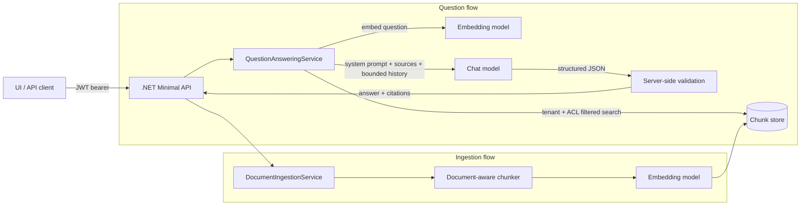
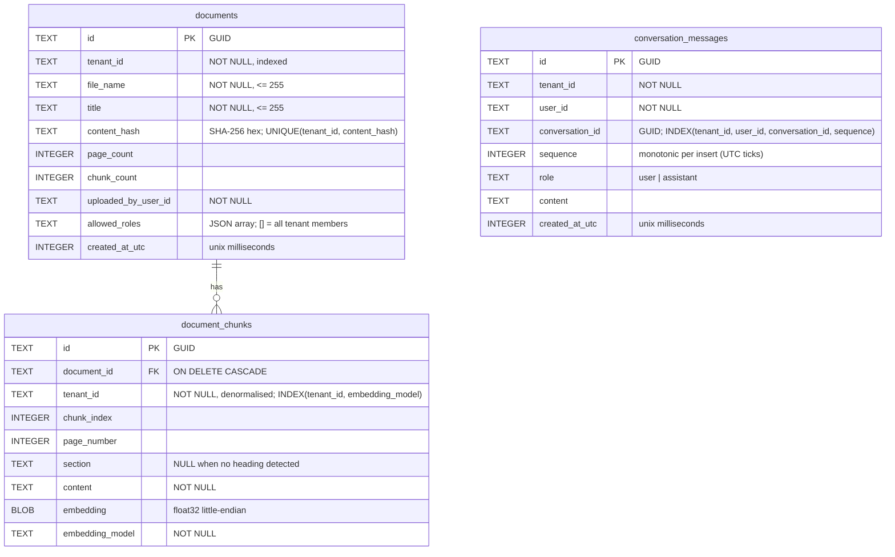

# 2. Architecture, database schema and API contracts

## System sketch



Ingestion: **extracted pages → section detection → chunking (size/overlap) → embeddings → store**.
Question: **question → embedding → filtered vector search → grounded prompt → model → validation → cited answer**.

## Projects

| Project | Responsibility | Depends on |
|---|---|---|
| `KnowledgeAssistant.Domain` | Entities and access rules (`Document`, `DocumentChunk`, `UserContext`) | nothing |
| `KnowledgeAssistant.Application` | Use cases, ports (interfaces), chunking, prompt building, output validation | Domain |
| `KnowledgeAssistant.Infrastructure` | Adapters: EF Core/SQLite store, OpenAI-compatible HTTP clients | Application |
| `KnowledgeAssistant.Api` | HTTP surface: endpoints, DTOs, authN/authZ, error mapping, OpenAPI | Application, Infrastructure (composition root only) |

Dependencies point inward (Dependency Inversion): Application defines `IChatModel`,
`IEmbeddingGenerator`, `IDocumentRepository` (reads), `IDocumentStore` (writes), `IChunkRetriever`,
`IConversationStore`;
Infrastructure implements them. Endpoints never touch `DbContext` or `HttpClient` directly.

## Security model

- **Authentication**: JWT bearer. Production: Microsoft Entra ID (`Authentication:Schemes:Bearer:Authority`
  + `ValidAudiences`). Development: `dotnet user-jwts` symmetric-key tokens. Same code path for both.
- **Claims**: tenant = `tid`; user id = `oid` (fallback `sub`); roles = `roles` (Entra app roles) or `role` (`user-jwts`).
- **Policies (RBAC)**:

  | Policy | Roles |
  |---|---|
  | `Documents.Read` | Reader, Contributor, Admin |
  | `Documents.Write` | Contributor, Admin |
  | `Questions.Ask` | Reader, Contributor, Admin |

  Every policy also requires a non-empty `tid` claim.
- **Tenant boundary**: every repository/retriever method takes the caller's `UserContext`/tenant id and
  filters in the query. There is no API to query across tenants.
- **Document ACL**: `Document.AllowedRoles` (empty = all tenant members). Enforced by
  `Document.IsAccessibleTo(user)` for metadata and by the retriever for chunks. Admins bypass the ACL *within their tenant only*.
- **Prompts are not a security boundary**: the model only ever receives chunks the caller is already
  allowed to read. Source text is wrapped as data and the system prompt tells the model to ignore
  instructions inside sources (defence in depth against prompt injection, not access control).

## Database schema (development store: SQLite via EF Core)



`tenant_id` is denormalised onto chunks so vector search can filter by tenant without trusting a join.
`embedding_model` is stored per chunk: vectors from different models are not comparable, so search
only considers chunks embedded with the currently configured model.

Production replacement: the same `IChunkRetriever`/`IDocumentRepository` ports map onto Azure AI Search
(tenant id + allowed roles as filterable fields) or PostgreSQL + pgvector.

## API contracts (v1)

All `/api/v1/*` endpoints require `Authorization: Bearer <jwt>`. Errors are `application/problem+json`.

| Method & path | Policy | Request | Success | Errors |
|---|---|---|---|---|
| `GET /health/live` | anonymous | – | 200 | – |
| `GET /health/ready` | anonymous | – | 200 | 503 |
| `GET /api/v1/documents?page=1&pageSize=20` | Documents.Read | – | 200 `PagedResponse<DocumentResponse>` | 400, 401, 403 |
| `GET /api/v1/documents/{id}` | Documents.Read | – | 200 `DocumentResponse` | 401, 403, 404 |
| `POST /api/v1/documents` | Documents.Write | `IngestDocumentRequest` | 201 `DocumentResponse` + `Location` | 400, 401, 403, 409, 503, 504 |
| `DELETE /api/v1/documents/{id}` | Documents.Write | – | 204 | 401, 403, 404 |
| `POST /api/v1/chat` | Questions.Ask | `ChatRequest` | 200 `ChatResponse` | 400, 401, 403, 503, 504 |
| `POST /api/v1/chat/stream` | Questions.Ask | `ChatRequest` | 200 `text/event-stream` | 400, 401, 403, 503 |
| `POST /api/v1/questions` | Questions.Ask | `QuestionRequest` | 200 `QuestionResponse` | 400, 401, 403, 502, 503, 504 |

```jsonc
// IngestDocumentRequest
{
  "fileName": "travel-policy.pdf",          // required, <= 255
  "title": "Travel Policy 2026",            // optional, defaults to fileName
  "allowedRoles": ["Finance.Reader"],       // optional; omitted/empty = all tenant members
  "pages": [ { "pageNumber": 1, "text": "# Scope\n..." } ]   // 1..N pages of extracted text
}

// DocumentResponse
{ "id": "…", "fileName": "…", "title": "…", "pageCount": 12, "chunkCount": 37,
  "allowedRoles": [], "uploadedByUserId": "…", "createdAtUtc": "2026-11-10T09:00:00Z" }

// QuestionRequest
{ "question": "How many days in advance must I book flights?", "conversationId": null }

// QuestionResponse — exactly two shapes: answered (>=1 citation) or unknown (0 citations)
{
  "conversationId": "…",
  "answerFound": true,
  "answer": "Flights must be booked at least 14 days in advance [1].",
  "citations": [
    { "sourceNumber": 1, "documentId": "…", "chunkId": "…", "fileName": "travel-policy.pdf",
      "title": "Travel Policy 2026", "pageNumber": 3, "section": "Booking", "snippet": "…" }
  ]
}

// ChatRequest / ChatResponse
{ "message": "Explain what a context window is.", "temperature": 0.2 }
{ "reply": "…", "model": "gpt-4o-mini", "usage": { "inputTokens": 21, "outputTokens": 80 } }
```

Status mapping for failures:

| Condition | Status |
|---|---|
| Body/query validation failed | 400 |
| Missing/invalid token | 401 |
| Missing role or tenant claim | 403 |
| Not found **or not accessible** to caller | 404 |
| Same content already ingested in tenant | 409 |
| Request body over the endpoint limit (64 KB chat/questions, 16 MB ingestion) | 413 |
| Per-user limit on model-backed endpoints exceeded | 429 |
| Model returned output that fails validation (after one retry) | 502 |
| Model provider not configured / unreachable / rejected the call | 503 |
| Model call timed out | 504 |

## Model contract for grounded answers

The model is asked (via `response_format: json_schema` when the provider supports it) for:

```json
{ "answerFound": true, "answer": "…", "citations": [1, 3] }
```

Server-side validation (`GroundedAnswerParser`) is authoritative: output is parsed, citation numbers are
checked against the sources actually sent, and anything inconsistent degrades to the safe unknown answer
or a 502 — it is never passed through.
